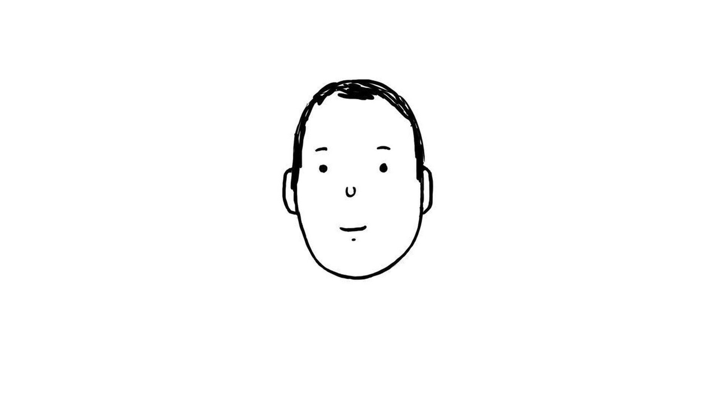

# Ink to Sky



A 15-second hand-drawn film made by an AI agent in an
[OpenCode](https://opencode.ai) harness, from two prompts, with the
**NorthNoir CLI** and **NorthCel**, the drawing language the film is written
in. **1920×1080, 20 fps, 300 frames, stereo AAC.**

▶ [`film/ink_to_sky_20fps.mp4`](film/ink_to_sky_20fps.mp4)

A boy drawn in ink on white paper looks around, jumps, falls through the paper
into a blue sky, lands on a cloud, and is lowered onto a green hill where a duck
waddles past.

## The two prompts

**1. The brief** drew the film:

> One continuous 15-second hand-drawn frame-by-frame section at 6 fps (90
> frames). The man from the reference drawing looks left and right, his body and
> clothes are inked in, he jumps, the white paper becomes blue sky with clouds,
> he falls and colour floods into him and his clothes, he lands on a cloud which
> drops him onto green grass, and a duck waddles past him.

**2. The polish** took those drawings to 20 fps: tracing every drawing into
NorthCel, drawing the frames in between, and building and checking the final
film with the NorthNoir CLI.

## How it was made

Images and code only. No frame was drawn or edited by hand.

| Piece | What it did |
| --- | --- |
| **Ruvil 7.3** (North Noir) | Drew the film frame by frame as images: 90 drawings made with **Sunburst 2.6**, plus 21 in-between drawings. |
| **NorthNoir CLI** | `northnoir polish` planned the film around the drawings, checked the palette against them, and `northnoir polish verify` measured the rendered frames against the drawings. |
| **NorthCel** (`.ncel`) | The language the film is written in. `northcel fit` traced every drawing into editable vector code; the whole film, the camera and the frames in between are NorthCel source, rendered by the NorthCel renderer. |

There are no raster frames in the film: the 300 frames are rendered from
`.ncel` source, and the sound is the music and effects produced with the
drawings.

## Repository layout

```
film/
  ink_to_sky_20fps.mp4     the film
  poster.jpg               poster frame
sources/
  cels/f0001…f0090.jpg     the 90 Ruvil 7.3 drawings (Sunburst 2.6, 1536×1024)
  start_face.jpg           the starting drawing
  extras/m*.jpg            in-between drawings and their prompts (report.json)
  sound/                   music, sound effects and the final mix
ncel/
  sources/                 every drawing traced to NorthCel, with its fit receipt
  film/                    the plan: keys, holds, cuts and transitions
  authored/                vector in-between blocks
  v7/film.ncel             the complete 300-frame film
process/
  polish/                  shared palette, plan config, in-between list
  v6/authoring.json        which drawing each frame comes from
  v7/                      the script that builds the film
```

The largest file is about 7 MB, so there is no Git LFS. Rendered frames are not
committed (`frames/` is in `.gitignore`).

## Build the film

Python 3.12 or newer and ffmpeg:

```sh
pip install "northnoir[ncel]" shapely scipy opencv-python-headless pillow numpy
python process/v7/build.py --out out
```

This writes `ncel/v7/film.ncel`, renders `out/frames/f0000.png … f0299.png`
and encodes `out/film.mp4` with the sound. Render only some frames with
`--frames 190..230`, or write only the `.ncel` with `--no-render`.

## Check the film

```sh
northnoir polish verify \
  --frames out/frames \
  --plan ncel/film/receipt.json \
  --cels sources/cels \
  --extra-keys process/polish/extra_keys.json \
  --out out/verify
```

It checks every frame against the drawing it came from: a mouth on every frame,
one eye style throughout, the figure complete and inside the frame, and the
right frame count and size.

Every drawing is covered by the shared palette:

```sh
northnoir polish palette check --cels sources/cels \
  --palette process/polish/palette.json --strict
```

Every `.ncel` file passes the validator:

```sh
find ncel -name '*.ncel' -print0 | xargs -0 -n1 northcel check
```

Useful views of the film:

```sh
northcel shapes ncel/v7/film.ncel --frame 0
northcel contact ncel/v7/film.ncel -o contact.png --frames 0..299 --every 20
northcel continuity ncel/v7/film.ncel --group figure
northcel distinct ncel/v7/film.ncel
northcel onion ncel/v7/film.ncel -o onion-f0150.png --frame 150
```

## Trace the drawings yourself

```sh
northcel fit sources/cels/f0062.jpg --stacked --palette process/polish/palette.json \
  -o f0062.ncel --receipt f0062.json
```

and the plan:

```sh
northnoir polish \
  --cels sources/cels --fps 20 --src-fps 6 \
  --palette process/polish/palette.json \
  --extra-keys process/polish/extra_keys.json \
  --audio-from sources/sound/ink_to_sky_mix.m4a \
  --out polish/
```
